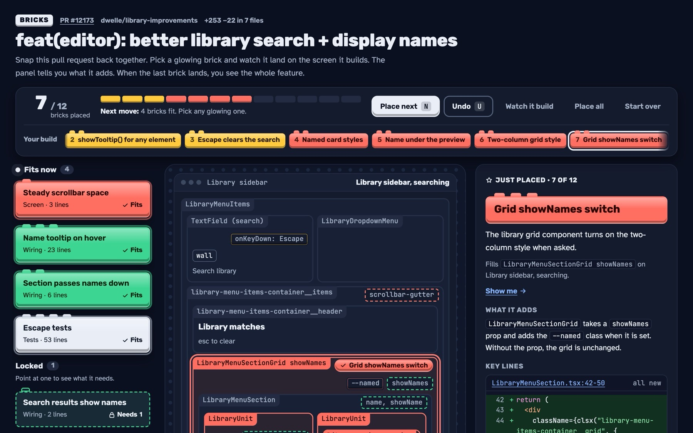

# bricks

Review AI code brick by brick.

AI agents now write pull requests faster than people can read them. A 2,000-line diff lands, the reviewer skims it, approves it, and hopes. The human is still in the loop on paper, but not in practice.

bricks is a Claude Code skill that cuts a pull request into 8 to 20 small pieces, called bricks, and hands them to you in the order the feature was built. You place one, read what it does, then place the next. When the last one lands you have seen every added line, and you know how the pieces fit.

It's closer to building a toy set than reading a wall of diff. That makes a big review something you can actually finish.

**[See it on a real PR →](https://azizpunjani.github.io/bricks/demo/)** (excalidraw/excalidraw#12173, 12 bricks, 236 lines)



## Install

As a Claude Code plugin:

```
/plugin install bricks --marketplace azizpunjani/bricks
```

Or copy the skill by hand:

```bash
git clone https://github.com/azizpunjani/bricks
cp -r bricks/skill ~/.claude/skills/bricks
```

It needs `gh` (logged in), `git`, `python3` and `node` 18 or later.

## Use it

In Claude Code:

```
/bricks https://github.com/owner/repo/pull/123
```

The plugin install names it `/bricks:bricks`. You can also just ask: "break this PR into bricks".

## How a run works

1. **Gather.** `gather.sh` pulls the PR with `gh`, clones its head into a scratch folder, and lists every added line with its line number.
2. **Cut.** Claude reads the diff and writes `bricks.json`: each brick's name, what it adds, which lines it owns, and which bricks it needs first.
3. **Build.** `build.mjs` checks the spec against the real diff and fills `template.html`. Code on the page is copied from the PR head, never retyped. If any added line is in no brick, it refuses to write the page.

You get one HTML file. Open it locally, put it on any static host, or publish it as a claude.ai Artifact.

## The spec

[`skill/example.json`](skill/example.json) is the full spec behind the demo. Each brick looks like this:

```json
{
  "id": "escape-clears",
  "layer": "logic",
  "name": "Escape clears the search",
  "job": "Pressing Escape in the search box clears the search instead of closing the sidebar.",
  "deps": [],
  "ranges": [{ "file": "packages/excalidraw/components/LibraryMenuItems.tsx", "start": 407, "end": 415 }],
  "key": [{ "file": "packages/excalidraw/components/LibraryMenuItems.tsx", "start": 407, "end": 415 }]
}
```

`layer` is one of `data`, `logic`, `ui`, `wiring` or `test`. `screens` sketches the UI the PR touches, and `summary` is five sentences for the end. [`skill/SKILL.md`](skill/SKILL.md) has every field.

## FAQ

**Why must every line be in a brick?**
So nothing hides. If a reviewer can finish the kit without seeing a line, that line was never reviewed. The build fails until coverage is 100%.

**Why dependency order?**
A brick can't be placed until the bricks it uses are down. So you read the data before the logic that reads it, and the logic before the screen that shows it. The order is the explanation.

**Does it judge the code?**
No. It explains the change so you can judge it. Pair it with whatever review you already do.

**Does it change my repo?**
No. It reads the PR and writes into a scratch folder.

## License

MIT
